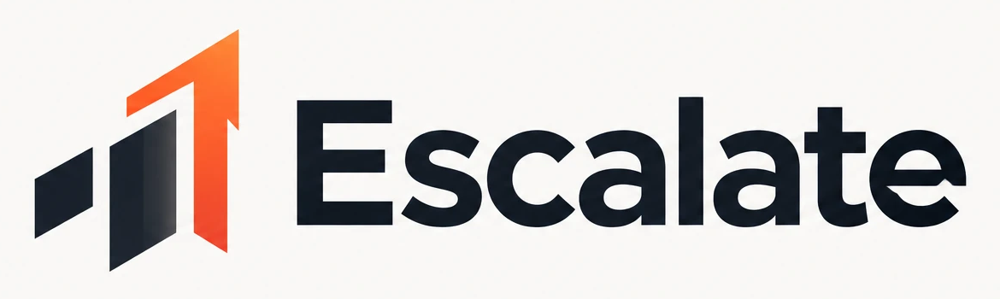
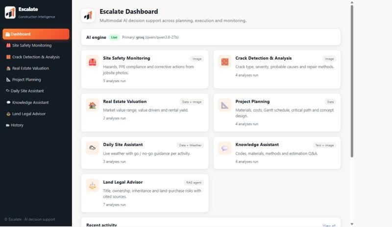
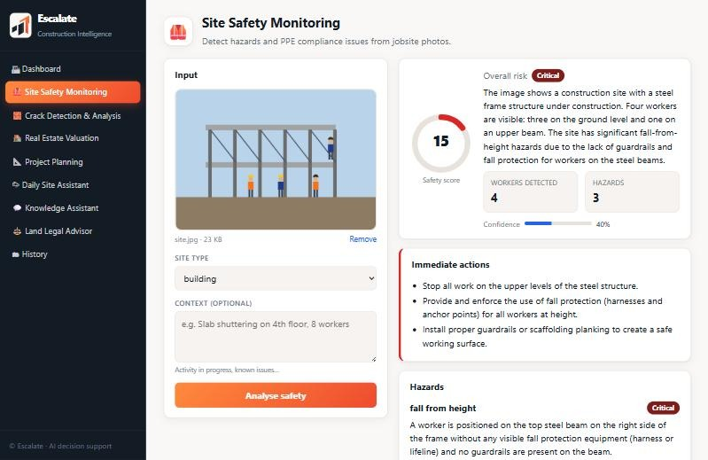
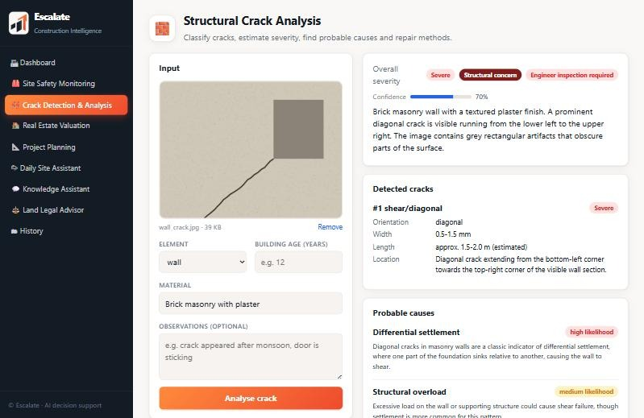
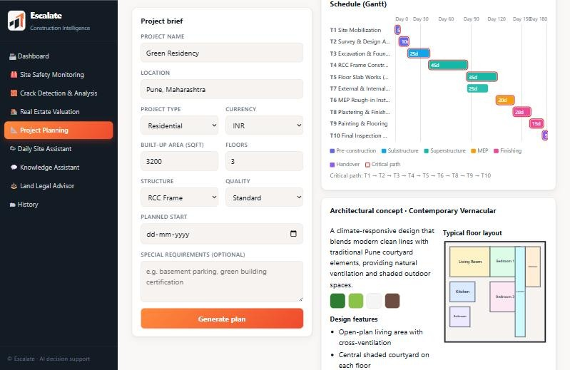
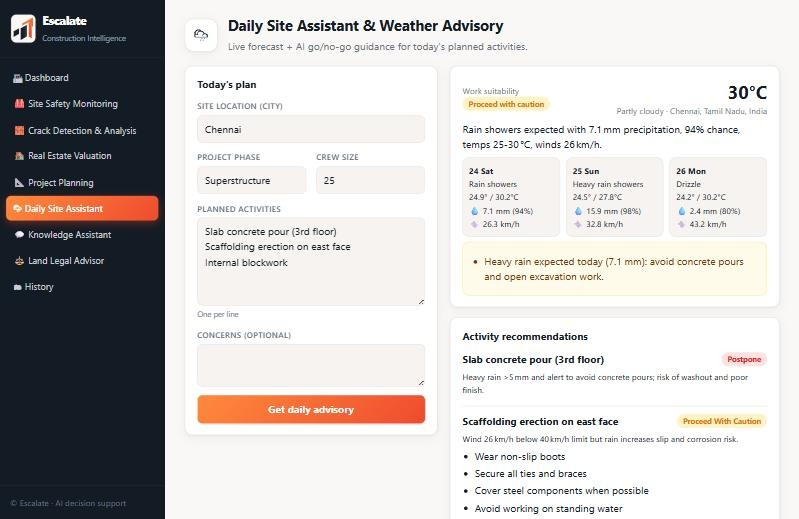
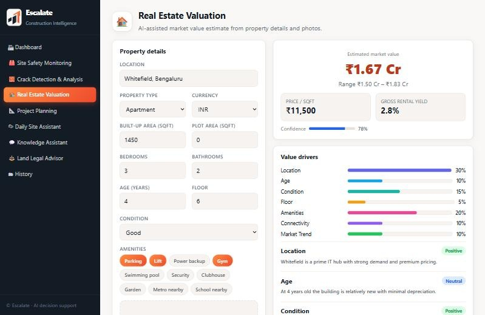
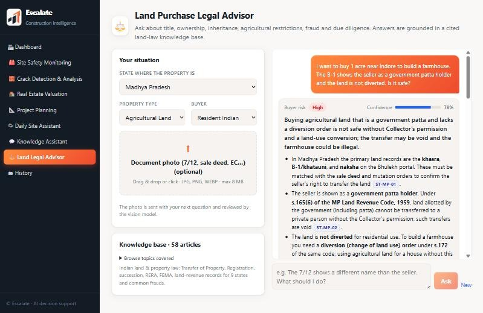

<p align="center">
  
</p>

<p align="center"><b>AI-powered multimodal construction intelligence: from site safety to land-purchase legal guidance.</b></p>

---

**Escalate** is a full-stack decision-support platform for construction professionals and property buyers. It analyses **construction images, text descriptions and structured project data** with multimodal LLMs and returns **strict, schema-validated JSON**. A React UI renders that JSON.

| Module | Input | Output |
|---|---|---|
| 🦺 Site Safety Monitoring | Jobsite photo + notes | Hazards (with location and regulation), PPE compliance, safety score, immediate actions |
| 🧱 Crack Detection & Analysis | Crack photo + element/material/age | Crack type, width, severity, probable causes, repair methods, engineer flag |
| 🏠 Real Estate Valuation | Property data + optional photo | Value range, price/sqft, value drivers, rental yield, outlook |
| 📐 Construction Planning | Project brief | Material quantities, cost breakdown, CPM schedule (Gantt + critical path), architectural concept + floor plan |
| 🌦 Daily Site Assistant | City + planned activities | Live 3-day forecast, weather alerts, go / caution / no-go per activity, toolbox talk, checklist |
| 💬 Knowledge Assistant | Multi-turn chat + optional image | Answer, key points, code references, safety notes, follow-up questions |
| ⚖️ **Land Legal Advisor** (RAG agent) | Question + state / property / buyer profile + optional document photo | Grounded answer with citations, buyer risk level, red flags, documents to verify, next steps, applicable laws |
| 🗂 History | — | Every analysis is stored with its inputs, output and image |

<p align="center"></p>

## Screenshots

| Site safety | Crack analysis |
|---|---|
|  |  |
| **Planning: Gantt + critical path** | **Daily site assistant** |
|  |  |
| **Real-estate valuation** | **Land legal advisor (RAG)** |
|  |  |

All screenshots show live Groq results. The layout is responsive down to phone width ([mobile view](docs/screenshots/08_mobile_dashboard.jpg)).

## Architecture

```
React + Vite (frontend/)  ──/api──►  FastAPI (backend/app)
                                     ├── routers/                API endpoints, input validation, response envelope
                                     ├── services/llm.py         multimodal gateway: Groq ▸ Hugging Face fallback
                                     │                           strict json_schema ▸ json_object ▸ prompt-only, auto-repair
                                     ├── services/legal_agent.py plan ▸ retrieve ▸ answer ▸ verify-citations agent
                                     ├── services/legal_kb.py    BM25 retriever over knowledge/land_law/*.md (58 articles)
                                     ├── services/estimator.py   deterministic quantities, costs, CPM scheduling
                                     ├── services/weather.py     Open-Meteo forecast + construction alert rules
                                     ├── services/images.py      image validation & quality checks
                                     ├── services/storage.py     SQLite history + uploaded files
                                     └── schemas.py              strict JSON data contracts (Pydantic)
```

**AI providers (free tiers).** Both use the OpenAI-compatible Chat Completions API:

| Provider | Vision model (images) | Text model | Fast model (agent planner) |
|---|---|---|---|
| Groq (primary) | `qwen/qwen3.8-27b` | `openai/gpt-oss-120b` | `openai/gpt-oss-20b` |
| Hugging Face Inference Providers (fallback) | `Qwen/Qwen3.8-27B` | `Qwen/Qwen3.8-27B` | `Qwen/Qwen3.8-27B` |

Model IDs are set through environment variables. With no API key configured, Escalate runs in **demo mode**: it returns deterministic responses in the same JSON shapes. In demo mode the legal advisor still performs real retrieval over its knowledge base.

## Land Legal Advisor: why RAG

Legal answers must be **grounded and citable**. A model on its own tends to invent section numbers and to mix up rules that differ between states. The advisor therefore uses retrieval-augmented generation over a curated knowledge base in `backend/app/knowledge/land_law/`. The 58 articles cover title and ownership, transactions and tax, inheritance and succession, land-type restrictions, disputes and fraud, due-diligence checklists, and state-specific records for **Maharashtra, Karnataka, Tamil Nadu, Telangana, Andhra Pradesh, Uttar Pradesh, Delhi, Gujarat and Madhya Pradesh**.

1. **Plan:** the fast model infers the state and the legal issues, and writes 2–4 search queries.
2. **Retrieve:** a BM25 keyword index with a legal synonym table (for example *satbara → 7/12*, *EC → encumbrance certificate*, *GPA → power of attorney*, *khasra / B-1 → record of rights*) and a state-aware ranking boost. This approach suits statutory terms, needs no embedding service or vector database, runs in milliseconds inside a serverless function, and is deterministic, so retrieval quality is unit-tested (25-question evaluation set, recall@5 = 100%).
3. **Answer:** the text model, or the vision model when a document photo such as a 7/12, B-1 or sale deed is attached, answers only from the retrieved passages and cites them inline, for example `[TX-04]`.
4. **Verify:** code removes citations to passages that were not retrieved, flags fabricated references, and lowers confidence when retrieval was weak. Off-topic questions are declined.

To extend the knowledge base, add more `.md` files in the same format (`## ID | Title`, followed by `jurisdiction:`, `topics:` and `sources:` lines and a body). They are indexed automatically on start-up.

## Project layout

| Path | Contents |
|---|---|
| `backend/app/main.py` | FastAPI application (`app`). Also serves `frontend/dist` when it exists. |
| `backend/requirements.txt` | Python dependencies (Python 3.10+; developed on 3.12) |
| `backend/.env.example` | All configuration variables, documented. Copy it to `.env`, which is git-ignored. |
| `backend/app/knowledge/land_law/` | Legal knowledge base (Markdown) |
| `backend/tests/` | 95 automated tests (pytest) |
| `frontend/` | React 19 + Vite 8 single-page app. During development the dev server proxies `/api` to port 8000. |
| `docs/` | Project documentation, testing report, deployment notes, screenshots and brand assets |

## Configuration (environment variables)

| Variable | Default | Purpose |
|---|---|---|
| `LLM_PROVIDER` | `groq` | Primary provider (`groq` or `huggingface`). The other one is used as fallback if its key is set. |
| `GROQ_API_KEY`, `HF_TOKEN` | — | Provider credentials. Never commit them. |
| `*_VISION_MODEL`, `*_TEXT_MODEL`, `*_FAST_MODEL` | see above | Model IDs per provider |
| `DEMO_MODE` | `false` | Force demo responses |
| `FALLBACK_TO_DEMO` | `false` | Serve labelled demo data if every live provider fails |
| `MAX_IMAGE_MB` | `8` | Upload limit. The browser also downscales photos to at most 1600 px before upload. |
| `LLM_TIMEOUT_SECONDS`, `LLM_TEMPERATURE` | `90`, `0.2` | Model call settings |
| `CORS_ORIGINS` | `http://localhost:5173,...` | Allowed browser origins (needed only when the frontend is hosted on a different domain) |
| `STORAGE_DIR` | `storage` | SQLite + uploads location (git-ignored). On Vercel it is always under `/tmp`. |
| `VITE_API_BASE` (frontend, build time) | empty | API origin when the frontend and backend are hosted separately |

## Deploying (Vercel + GitHub)

The code is ready for Vercel's Python runtime. See [docs/DEPLOYMENT.md](docs/DEPLOYMENT.md) for what the platform needs:
- the FastAPI entrypoint `backend/app/main.py:app`;
- where the requirements file is;
- the frontend build output;
- environment variables;
- serverless limits, which are already handled in code: 4.5 MB request bodies (client-side compression) and a read-only filesystem (`/tmp` storage).

## Strict JSON contracts

Every endpoint returns one of two envelopes:

```jsonc
{ "success": true,  "data": { /* module contract */ }, "meta": { "mode": "live|demo", "provider": "groq", "model": "...", "latency_ms": 1374, "warnings": [], "record_id": 9 } }
{ "success": false, "error": { "code": "corrupted_image", "message": "The image appears to be corrupted or incomplete...", "details": null } }
```

How the contract is enforced:
1. Pydantic models are converted into self-contained strict JSON schemas and sent as `response_format: json_schema (strict)`.
2. If a provider rejects that format, the call degrades to `json_object`, then to prompt-only JSON.
3. Each reply is cleaned (`<think>` blocks and code fences removed), parsed, validated and normalised.
4. If validation fails, the model is asked once to repair its own output. If that also fails, the next provider is tried.
5. FastAPI validates the final envelope against `response_model`.
6. The frontend reads every field defensively and wraps each page in an error boundary.

## Testing

The test suite is in `backend/tests` (pytest). It runs fully offline, with providers and weather mocked: 95 tests covering functional behaviour, contracts, edge cases, the AI layer, the legal agent and the RAG retrieval evaluation. See [docs/TESTING_REPORT.md](docs/TESTING_REPORT.md).

## Documentation
- [docs/PROJECT_DOCUMENTATION.md](docs/PROJECT_DOCUMENTATION.md): prerequisites, workflow, Epics 1–6, and the legal advisor
- [docs/TESTING_REPORT.md](docs/TESTING_REPORT.md): test plan and results
- [docs/DEPLOYMENT.md](docs/DEPLOYMENT.md): deployment notes, demo script, known limitations

> ⚠️ AI outputs are decision **support** only. Crack and safety assessments do not replace an on-site inspection. Valuations are indicative. The Land Legal Advisor provides general legal information, not legal advice; have a property advocate verify title before paying.
